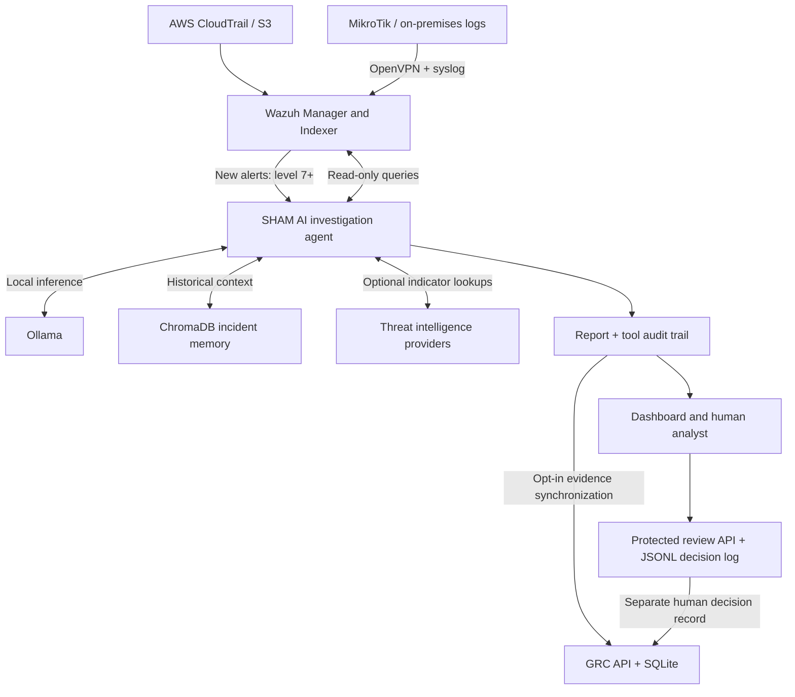

# Sham-AI-SOC & GRC

**Hybrid AI-SOC Agent with Integrated GRC**

**Project website:** [Explore SHAM AI / SOC & GRC](https://majdalhumidi.github.io/Sham-AI-SOC-GRC/)

[](https://github.com/MajdAlhumidi/Sham-AI-SOC-GRC/actions/workflows/soc-agent-tests.yml)

SHAM AI helps security analysts investigate Wazuh alerts, gather supporting evidence, and document their decisions. It combines local AI inference through **Ollama**, historical incident retrieval through **ChromaDB**, and a **human review workflow** with an integrated governance, risk, and compliance foundation.

The project brings together AWS cloud telemetry and on-premises MikroTik monitoring. Its goal is to reduce repetitive triage work while keeping the analyst responsible for the final security decision.

> **Current stage: development prototype.** The agent investigates and recommends. It does not isolate hosts, block addresses, or execute containment. GRC records evidence and approvals; it does not certify compliance.

**Explore:** [Capabilities](#capabilities) · [Architecture](#architecture) · [Setup](#setup) · [GRC](#grc-integration) · [Human review](#human-review) · [Tests](#tests-and-evaluation) · [Roadmap](#roadmap)

**Case workspace:** persistent analyst follow-up questions, read-only evidence collection,
and redacted portable evidence packs are available inside **Investigations → Cases**.
The separate **Comparison lab** runs blind manual / actual-model assessments over the
same 16 labelled synthetic scenarios. No human baseline or productivity improvement is
invented; AI-only trials, errors and sample limits are explicit.
See [case follow-ups and evidence](docs/case-followups-and-evidence.md) and
[comparison experiment](docs/comparison-experiment.md).
The [investigation study](docs/investigation-study.md) adds a blinded manual
and agent-assisted comparison using the same alert and evidence tools.

## Capabilities

| Component | Current implementation |
| --- | --- |
| Alert intake | Monitors new Wazuh JSON alerts with rule level **7 or higher**. |
| Local AI investigation | Uses Ollama by default; the model selects relevant read-only tools and reassesses their results. |
| Incident memory | Stores incident reports in ChromaDB and retrieves similar historical cases. |
| Evidence collection | Queries Wazuh Indexer for related alerts, process events, and network activity. |
| Threat intelligence | Optional AbuseIPDB, VirusTotal, and GreyNoise lookups with explicit provider availability. |
| Reporting | Produces structured investigation reports, checks required sections, and enforces `NOT_EXECUTED` containment status. |
| Analyst dashboard | SOC incidents, protected Investigations and GRC workspaces, with links between source reports and evidence. |
| Correlated investigations | Conservative grouping by observed asset, rule, source, account and a bounded 30-minute window; timeline and relationship view. |
| Auditable findings | Original alerts, captured tool results, clickable evidence references, integrity fingerprints and explicit missing-evidence labels. |
| Business-aware priority | Editable asset criticality, ownership and data sensitivity; explained scores and exact approved-change context without alert suppression. |
| Human review | Protected API records `accepted`, `corrected`, or `escalated` decisions separately from AI suggestions. |
| GRC foundation | SQLite-backed risk register, control catalogue, evidence, approval records, and audit events. |
| SOC-to-GRC connection | Opt-in synchronization of incident provenance and human decisions into GRC evidence. |
| Case management | Optional TheHive case creation after report validation and an authenticated approval for that incident. |

### Investigation boundaries

**Using the new workspace:** open **Investigations** in the Agent dashboard;
records load directly without a workspace token. See [Investigation workspace](docs/investigations.md)
for correlation rules, priority scoring, asset/change forms, legacy data limits
and the one-time import command.

- Tool calls are limited to a configurable budget: **6 by default, up to 12**.
- Endpoint queries are restricted to the agent identified in the incoming alert.
- External IP lookups require an observed, globally routable address. File-hash lookups must also reference observed indicators.
- Missing credentials, empty evidence, and failed queries are recorded as such; they are not proof that an event is benign.
- Report format validation checks structure, not the factual correctness of an investigation.
- Historical classifications are context. They are not trusted ground truth unless their review metadata supports that interpretation.

## Architecture



**Investigation flow:** receive an alert → select evidence tools → assess the returned results → produce and validate a report → persist the incident → present it for human review.

When enabled, GRC receives evidence references after persistence. The original AI assessment and the human decision remain separate. Optional Gemini inference and TheHive case creation are additional integrations, not required parts of the local Ollama path.

### Technology stack

| Layer | Technologies |
| --- | --- |
| Monitoring and telemetry | Wazuh, AWS CloudTrail, MikroTik RouterOS, syslog |
| Application | Python, FastAPI, WebSocket |
| AI runtime | Ollama; optional Google Gemini |
| Historical retrieval | ChromaDB, Sentence Transformers (`all-MiniLM-L6-v2`) |
| GRC storage | SQLite |
| Connectivity and hosting | OpenVPN; Ubuntu on AWS EC2 or an appropriately configured local server |
| Optional integrations | AbuseIPDB, VirusTotal, GreyNoise, TheHive |

## Setup

The commands below target **Ubuntu/Linux**. They start the application against an existing lab; they do not provision Wazuh, AWS, networking, or systemd services.

### 1. Prepare the environment

You need:

- Python **3.11 or later**; CI runs on Python 3.11.
- Wazuh alerts available at `/var/ossec/logs/alerts/alerts.json`, with read access for the SOC process.
- Wazuh Indexer access for evidence queries, using appropriate credentials and trusted TLS certificates.
- A running Ollama instance and a model with tool-calling support. The configured default is `qwen2.5:7b`.
- The embedding model available locally. Prepare model files and dependencies before using an offline environment.

For a **new checkout** on the existing Ubuntu layout:

```bash
git clone https://github.com/MajdAlhumidi/Sham-AI-SOC-GRC.git /home/ubuntu/soc-ai-agent
cd /home/ubuntu/soc-ai-agent
python3 -m venv .venv
source .venv/bin/activate
python -m pip install -r scripts/requirements.txt
```

For an existing checkout, use its current directory instead of cloning over it.

**Storage path requirement:** the agent writes ChromaDB to `./incident_vector_db`, relative to its working directory. The dashboard currently reads `/home/ubuntu/soc-ai-agent/incident_vector_db`. Run the agent from `/home/ubuntu/soc-ai-agent`, or align the dashboard's `CHROMA_DB_PATH` with your chosen location before starting it.

### 2. Configure the agent

Set these variables in the SOC agent's environment:

```bash
export SOC_LLM_PROVIDER=ollama
export SOC_OLLAMA_URL=http://127.0.0.1:11434/api/chat
export SOC_OLLAMA_MODEL=qwen2.5:7b
export SOC_OLLAMA_TIMEOUT_SECONDS=180
export SOC_AGENT_MAX_TOOL_STEPS=6
export SOC_AUDIT_LOG_PATH=/home/ubuntu/soc-ai-agent/logs/agent_audit.jsonl
export SOC_THEHIVE_AUTO_CREATE=false

export WAZUH_INDEXER_HOST=https://localhost:9200
export WAZUH_INDEXER_USER='replace-with-indexer-user'
export WAZUH_INDEXER_PASS='replace-with-indexer-password'
export WAZUH_INDEXER_VERIFY_TLS=true
# Optional for a private CA; the host must match the certificate SAN.
export WAZUH_INDEXER_CA_CERTS=/usr/local/share/sham-ai/wazuh-root-ca.pem
```

Replace credential placeholders with your deployment values and keep secrets outside Git. Model selection must match a model actually installed in Ollama.
Before contacting a model provider, the runtime performs one audited ChromaDB search within the incoming Wazuh rule and excludes stored reports of the same source alert. Retrieved case IDs, rule descriptions, vector distances, and review flags appear in **Historical Memory Context**, including when Ollama is offline and a fallback report is generated. This lookup uses the cached Sentence Transformers embedding model on the agent host; it does not require Ollama. Empty results and search failures are reported explicitly. Similarity alone does not establish unauthorized access or a common actor.

Ollama investigation runs in two phases. First, native tool calls collect evidence using only the incoming agent ID and observed indicators. Tool results are returned with Ollama's `tool_name` field. Then a separate request without tools uses a JSON schema for the assessment, findings, evidence references, limitations, and recommendations. Validated content is rendered into the required report sections; containment, provider status, and historical-query status come from runtime records.

MITRE IDs are restricted to mappings present in cited structured Wazuh rule evidence; absence of a supplied mapping is stated explicitly. Unknown evidence references, incomplete/truncated output, and text pretending to be a function call are not accepted as a final report. One bounded repair request is allowed for invalid structured output. If synthesis still fails, the existing fallback path remains explicit and preserves the actual tool trace. Context is bounded to 4,096 tokens, with separate output budgets for tool selection and report writing, four CPU threads, and a reduced evaluation batch to limit memory pressure. CPU inference may require increasing `SOC_OLLAMA_TIMEOUT_SECONDS` (maximum 300 seconds per request).

See Ollama's [tool-calling protocol](https://docs.ollama.com/capabilities/tool-calling) and [structured-output API](https://docs.ollama.com/capabilities/structured-outputs). Schema and report-format validation do not prove the factual correctness of a classification; analyst review remains necessary.

### 3. Start the application

On Python 3.13+, a legacy Wazuh CA without a Key Usage extension may fail strict X.509 checks. Prefer reissuing the CA. As an explicit compatibility setting, `WAZUH_INDEXER_TLS_STRICT=false` with `WAZUH_INDEXER_CA_CERTS` keeps certificate-chain, expiry, and hostname verification enabled while accepting that older CA format. Strict validation remains the default.

Start the API and dashboard from the repository root:

```bash
python -m uvicorn scripts.api_server:app --host 127.0.0.1 --port 8000
```

In another terminal, activate the same environment, apply the agent settings, and start monitoring:

```bash
cd /home/ubuntu/soc-ai-agent
source .venv/bin/activate
python scripts/soc_agent.py
```

The dashboard is available at `http://127.0.0.1:8000/` on that host. Use a protected connection to access a remote server. The agent broadcasts to the local API on port 8000.

On first use the monitor starts at the last complete line in the live alert file. It then saves its byte checkpoint and pending investigations in SQLite at `SOC_ALERT_INTAKE_DB_PATH` (default `data/alert-intake.sqlite3`). Use the same persistent database across restarts. The agent recovers unread records from retained Wazuh alert rotations (including compressed archives) and retries incomplete investigations with the original incident ID. Give the agent read access to the live alert log and its retained archives, and write access to the state directory. Retain archives long enough to cover downtime. A missing archive can leave an observable recovery gap.

An existing `SOC_ALERT_RESUME_FILE` cutover cursor can initialize a new intake database once. The native MikroTik template recognizes `MikroTik` and the previous identity. Its first matching failure uses rule 100111 at level 7 and enters the default AI workflow. See [native MikroTik rules](configs/wazuh/MIKROTIK_NATIVE.md).

For persistent deployments, configure each process's working directory and environment in its service configuration. Shell exports do not update already-running systemd services. Restart the relevant services after changing their configuration.

## GRC integration

The GRC foundation provides a risk register with a 5×5 likelihood–impact score, internal controls, risk-to-control mappings, evidence references, approvals, and audit records through `/api/grc`.

### Enable synchronization

Set the following in **both the SOC agent and API service environments**:

```bash
export SOC_GRC_ENABLED=true
export GRC_DB_PATH=/var/lib/sham-ai/grc.sqlite3
```

Use the same absolute database path on the same host and a local filesystem. The service accounts must be able to write the database directory.

GRC and Investigations open directly inside the Agent dashboard without an
additional token. Their APIs share the dashboard deployment's access controls;
`SOC_GRC_API_TOKEN` and `X-GRC-Token` are no longer required, including for writes.

```bash
curl -sS http://127.0.0.1:8000/api/grc/health
```

### What is synchronized

| Source | GRC evidence link | Information retained |
| --- | --- | --- |
| Wazuh alert | `SHAM-LOG-001` | Incident and alert references, rule, host, and timestamp |
| AI assessment | `SHAM-AI-002` | Classification, actual model/provider, fallback flag, report fingerprint, and containment status |
| Human review | `SHAM-AI-001` | Original review ID, incident ID, reviewer label, decision, and final classification when supplied |

Synchronization is **disabled by default**. Identical bridge events are deduplicated. Full raw logs and model reports remain in the original SOC store.

If synchronization fails, the original incident or review remains saved. The failure is reported in agent logs or the review response's `grc_sync` field. There is no automatic retry queue; failed mirrors require reconciliation from the retained source.

These links do not automatically set risk ratings, mark controls implemented, or authorize a response. The control catalogue is an internal baseline, not a validated ISO 27001 or NIST mapping.

### GRC dashboard tab

Open the existing Agent dashboard, select **GRC workspace**; records load immediately without a code. The direct route is `/#grc/evidence` on the dashboard host. Use the same protected connection as the SOC dashboard; the GitHub Pages website does not serve live incident or GRC data.

The tab provides **Risks, Controls, Evidence, Approvals, and Audit trail**, with summary counts, server-side search, status/source filters, pagination, record details, and links to related SOC investigations. It displays existing records only; creation, edits and approval decisions remain available through the existing APIs on the dashboard host. If a SOC incident was removed, its retained GRC evidence remains visible and the link explains that the source incident is unavailable.

There is no workspace unlock form or Lock button. New SOC alerts show a refresh notice while GRC is open, preserving the current GRC session. The control implementation indicator is not a compliance certification.

See the [GRC module guide](scripts/grc/README.md) for endpoints, request examples, scoring bands, and storage details.

## Human review

The analyst's decision is recorded separately from the model's suggestion using `POST /api/reviews`.

Configure the **API service** with a dedicated human-review secret:

```bash
export SOC_REVIEW_API_TOKEN='replace-with-a-different-long-random-secret'
export SOC_HUMAN_REVIEW_LOG_PATH=/home/ubuntu/soc-ai-agent/logs/human_reviews.jsonl
```

The endpoint returns `503` until a token is configured. Requests require `X-Review-Token`; invalid credentials return `401`.

| Decision | Meaning |
| --- | --- |
| `accepted` | Retains the agent's classification as the recorded human decision. |
| `corrected` | Requires a final classification different from the agent's suggestion. |
| `escalated` | Records escalation without asserting a final classification. |

<details>
<summary>Example: record a correction using fictional data</summary>

```bash
curl -sS http://127.0.0.1:8000/api/reviews \
  -H "X-Review-Token: ${SOC_REVIEW_API_TOKEN}" \
  -H "Content-Type: application/json" \
  -d '{
    "incident_id": "INC-DEMO-0001",
    "agent_classification": "suspicious",
    "decision": "corrected",
    "final_classification": "false_positive",
    "reviewer": "analyst-01",
    "notes": "Approved maintenance activity was confirmed during review.",
    "agent_recommendations": ["Review authentication events around the alert timestamp"]
  }'
```

</details>

Reviews are appended to JSONL with restrictive file permissions where supported. They are not automatically promoted into trusted ChromaDB memory. The review token controls access to the review API. GRC and Investigations rely on dashboard deployment access; caller-supplied reviewer or actor labels are not independently verified user identities.

## Optional integrations

| Integration | Configuration | Behavior |
| --- | --- | --- |
| Google Gemini | `SOC_LLM_PROVIDER=gemini`, `GEMINI_API_KEY`, optional `GEMINI_MODEL` | Alternative inference provider; configured default model is `gemini-2.5-flash`. |
| AbuseIPDB | `ABUSEIPDB_API_KEY` | Public IP reputation lookup |
| VirusTotal | `VIRUSTOTAL_API_KEY` | Public IP and observed file-hash lookups |
| GreyNoise | `GREYNOISE_API_KEY` | Public IP context |
| TheHive | `THEHIVE_URL`, `THEHIVE_API_KEY`, `THEHIVE_API_VERSION` | Operator-submitted case creation with an approval for the incident |

TheHive supports `v4` and `v5` API paths, with `v4` as the default. In token mode, create an approval for the incident with action `thehive.create_case` and have a distinct authenticated approver decide it. The operator submits the retained report from the configured runtime using `python -m scripts.thehive_tool --incident-id <ID> --approval-id <ID>`. A previous submission with an uncertain result requires reconciliation before another delivery. The model's tools are read-only.

Local model inference does not by itself make every integration offline. Gemini sends inference requests externally, and enabled threat-intelligence tools send permitted indicators to their providers. Prepare model caches and disable external integrations when designing an isolated deployment.

## Security and operational notes

- **Containment:** read-only investigation tools cannot isolate or block a target. Runtime report controls preserve `NOT_EXECUTED`; GRC approval records do not execute actions.
- **Service access.** Use `SOC_API_AUTH_MODE=disabled` for loopback development. Use `SOC_API_AUTH_MODE=token` behind a TLS reverse proxy and bind the upstream application to loopback. Set the exact browser URL in `SOC_ALLOWED_ORIGINS` and `SOC_WEBSOCKET_ALLOWED_ORIGINS`. Configure distinct service and UI credentials through the service environment. Sessions and rate limits are process-local, so use one API worker for this deployment or provide equivalent shared controls at the ingress.
- **Role assignment.** Give individual credentials stable actor IDs through `SOC_API_TOKENS_JSON`. Grant `SOC_READER` for the dashboard shell, `GRC_READER` for GRC views, `GRC_AUDITOR` for the GRC audit records, and `CASE_APPROVER` for approval decisions as required. Follow [.env.example](.env.example) for the role and origin settings.
- **GRC integrity.** The database migration chains existing audit and evidence rows without rewriting their contents. The chains verify sequence, links, row contents, and coverage within the local database. Use `scripts.grc.db.verify_integrity_chains()` for a verification snapshot.
- **Embedded ChromaDB.** Run Chroma in-process through `PersistentClient`. The pinned dependency audit documents four version-specific Chroma HTTP server advisories for which this deployment has no listening Chroma API. Review these exceptions when updating Chroma or changing its deployment mode.
- **TLS:** verification is enabled by default for Wazuh API, Wazuh Indexer, and TheHive. Install trusted certificates rather than disabling verification in production.
- **Secrets and data:** keep credentials, logs, incident databases, and personal or organizational data outside version control. Back up the SOC store, review log, and GRC database according to your retention policy.
- **Audit limits:** JSONL append behavior and SQLite audit triggers provide application-level traceability. They are not protection against a privileged administrator modifying the underlying storage.
- **Incident identity:** new incidents use a full UUID and retain `source_alert_id` in vector metadata for reconciliation with Wazuh; legacy IDs remain unchanged.
- **Legacy records:** older incidents may lack provider, review, or containment metadata. Review historical labels before using them as verified evaluation data.

## Repository guide

| Path | Purpose |
| --- | --- |
| [`scripts/soc_agent.py`](scripts/soc_agent.py) | Main alert monitoring and investigation workflow |
| [`scripts/investigation_agent.py`](scripts/investigation_agent.py) | Adaptive tool loop, argument validation, and tool audit trail |
| [`scripts/ollama_reporting.py`](scripts/ollama_reporting.py) | Structured assessment validation, evidence references, and report rendering |
| [`scripts/agent_tools.py`](scripts/agent_tools.py) | Evidence-tool adapters and dispatch |
| [`scripts/vector_store.py`](scripts/vector_store.py) | ChromaDB persistence and retrieval |
| [`scripts/api_server.py`](scripts/api_server.py) | Dashboard, WebSocket, review API, and GRC routing |
| [`scripts/report_quality.py`](scripts/report_quality.py) | Report structure checks and containment-status enforcement |
| [`scripts/review_audit.py`](scripts/review_audit.py) | Separate human-review records |
| [`scripts/grc/`](scripts/grc/) | GRC APIs, SQLite storage, scoring, audit, and SOC evidence bridge |
| [`configs/`](configs/) | AWS, MikroTik, OpenVPN, and Wazuh configuration examples |
| [`scripts/tests/`](scripts/tests/) | Investigation, report, review, and TheHive tests |
| [`tests/`](tests/) | GRC scoring and merged SOC/GRC integration tests |

Configuration examples use deployment-specific values and must be adapted to the target environment. The MikroTik logging example is stored as [`configs/mikrotik/.logging-setup`](configs/mikrotik/.logging-setup); Wazuh rules are in [`configs/wazuh/custom_rules.xml`](configs/wazuh/custom_rules.xml).

<details>
<summary>Existing lab screenshots and network diagram</summary>

These assets document the monitoring lab; they are not a current GRC dashboard or proof of live AI performance.

- [AWS/Wazuh dashboard](docs/aws-wazuh-dashboard.PNG)
- [MikroTik alerts](docs/mikrotik-alerts.PNG)
- [OpenVPN status](docs/openvpn-status.PNG)
- [Network topology](diagrams/architecture-topology.png)

</details>

## Tests and evaluation

Run from the repository root in a dedicated test environment:

```bash
python -m pip install requests fastapi httpx opensearch-py python-dotenv
python -m compileall -q scripts tests
PYTHONPATH=scripts python -m unittest discover -s scripts/tests -v
python -m unittest discover -s tests -v
```

The commands use Linux shell syntax. On Windows, run the script-level tests from the `scripts` directory, then run the root-level tests from the repository root.

The suite covers investigation boundaries, native tool-result feedback, malformed tool-call text, wrong agent IDs, incomplete/truncated reports, invented evidence references, bounded repair, report controls, human-review behavior, TheHive response handling, GRC access protection, evidence synchronization, risk scoring, and append-only audit behavior. Integration tests use temporary SQLite databases and mocked model/security services. CI runs on pushes to `main` and feature branches, and pull requests targeting `main`.

**Live validation is separate:** passing these tests does not establish detection accuracy, model quality, or performance on an AWS deployment. The Comparison lab supports paired manual/model review of the same synthetic evidence, with explicit failures, reference checks and wall-time measurements. A genuine human baseline and independently adjudicated, held-out operational evaluation remain to be completed. No measured productivity improvement percentage is claimed here.

## Roadmap

- [x] Wazuh alert intake and historical incident retrieval
- [x] Local Ollama investigation with bounded read-only tools
- [x] Report quality checks and explicit containment status
- [x] Human-review API and separate decision log
- [x] GRC risk, control, evidence, approval, and audit APIs
- [x] SOC incident and human-review evidence synchronization
- [x] Automated checks on `main`
- [x] Persistent case follow-ups with bounded read-only tools and evidence references
- [x] Redacted portable evidence packs with printable report and fingerprint manifest
- [x] Isolated synthetic comparison lab with blind manual review and actual-model trials
- [ ] Measured comparison of manual and AI-assisted triage
- [ ] Curated feedback from reviewed incidents into trusted memory
- [x] GRC dashboard tab with search, pagination and linked incident investigations
- [ ] Individual GRC user identities and role-based access management
- [ ] Validated mappings to selected governance and compliance frameworks
- [ ] Reproducible deployment packaging and broader offline validation

Real response adapters remain future work and require explicit authorization, bounded permissions, and auditable execution.

---

Developed by [Majd Alhumidi](https://github.com/MajdAlhumidi). **SHAM AI keeps the analyst in control of the security decision.**
