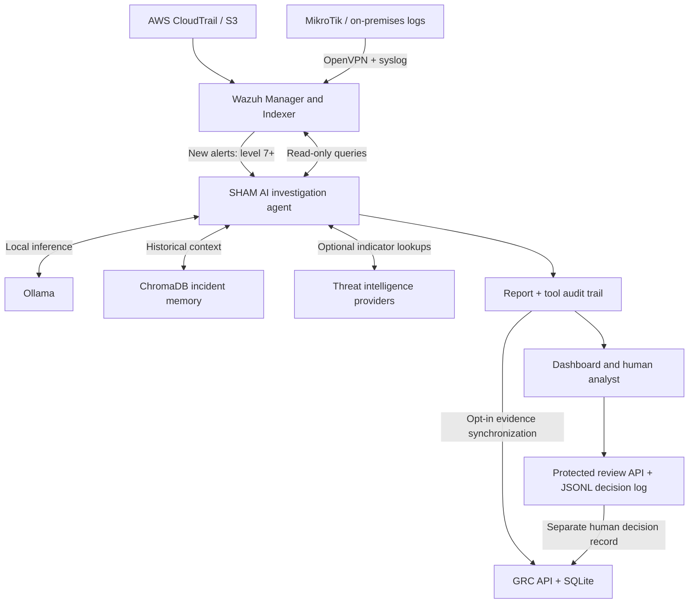

# Sham-AI-SOC & GRC

**Hybrid AI-SOC Agent with Integrated GRC**

**Project website:** [Explore SHAM AI / SOC & GRC](https://majdalhumidi.github.io/Sham-AI-SOC-GRC/)

[](https://github.com/MajdAlhumidi/Sham-AI-SOC-GRC/actions/workflows/soc-agent-tests.yml)

SHAM AI helps security analysts investigate Wazuh alerts, gather supporting evidence, and document their decisions. It combines local AI inference through **Ollama**, historical incident retrieval through **ChromaDB**, and a **human review workflow** with an integrated governance, risk, and compliance foundation.

The project brings together AWS cloud telemetry and on-premises MikroTik monitoring. Its goal is to reduce repetitive triage work while keeping the analyst responsible for the final security decision.

> **Current stage: development prototype.** The agent investigates and recommends. It does not isolate hosts, block addresses, or execute containment. GRC records evidence and approvals; it does not certify compliance.

**Explore:** [Capabilities](#capabilities) · [Architecture](#architecture) · [Setup](#setup) · [GRC](#grc-integration) · [Human review](#human-review) · [Tests](#tests-and-evaluation) · [Roadmap](#roadmap)

## Capabilities

| Component | Current implementation |
| --- | --- |
| Alert intake | Monitors new Wazuh JSON alerts with rule level **7 or higher**. |
| Local AI investigation | Uses Ollama by default; the model selects relevant read-only tools and reassesses their results. |
| Incident memory | Stores incident reports in ChromaDB and retrieves similar historical cases. |
| Evidence collection | Queries Wazuh Indexer for related alerts, process events, and network activity. |
| Threat intelligence | Optional AbuseIPDB, VirusTotal, and GreyNoise lookups with explicit provider availability. |
| Reporting | Produces structured investigation reports, checks required sections, and enforces `NOT_EXECUTED` containment status. |
| Analyst dashboard | FastAPI and WebSocket interface for incident reports, classifications, and recorded execution status. |
| Human review | Protected API records `accepted`, `corrected`, or `escalated` decisions separately from AI suggestions. |
| GRC foundation | SQLite-backed risk register, control catalogue, evidence, approval records, and audit events. |
| SOC-to-GRC connection | Opt-in synchronization of incident provenance and human decisions into GRC evidence. |
| Case management | Optional TheHive case creation after report validation and explicit configuration. |

### Investigation boundaries

- Tool calls are limited to a configurable budget: **6 by default, up to 12**.
- Endpoint queries are restricted to the agent identified in the incoming alert.
- External IP lookups require an observed, globally routable address. File-hash lookups must also reference observed indicators.
- Missing credentials, empty evidence, and failed queries are recorded as such; they are not proof that an event is benign.
- Report format validation checks structure, not the factual correctness of an investigation.
- Historical classifications are context. They are not trusted ground truth unless their review metadata supports that interpretation.

## Architecture



**Investigation flow:** receive an alert → select evidence tools → assess the returned results → produce and validate a report → persist the incident → present it for human review.

When enabled, GRC receives evidence references after persistence. The original AI assessment and the human decision remain separate. Optional Gemini inference and TheHive case creation are additional integrations, not required parts of the local Ollama path.

### Technology stack

| Layer | Technologies |
| --- | --- |
| Monitoring and telemetry | Wazuh, AWS CloudTrail, MikroTik RouterOS, syslog |
| Application | Python, FastAPI, WebSocket |
| AI runtime | Ollama; optional Google Gemini |
| Historical retrieval | ChromaDB, Sentence Transformers (`all-MiniLM-L6-v2`) |
| GRC storage | SQLite |
| Connectivity and hosting | OpenVPN; Ubuntu on AWS EC2 or an appropriately configured local server |
| Optional integrations | AbuseIPDB, VirusTotal, GreyNoise, TheHive |

## Setup

The commands below target **Ubuntu/Linux**. They start the application against an existing lab; they do not provision Wazuh, AWS, networking, or systemd services.

### 1. Prepare the environment

You need:

- Python **3.11 or later**; CI runs on Python 3.11.
- Wazuh alerts available at `/var/ossec/logs/alerts/alerts.json`, with read access for the SOC process.
- Wazuh Indexer access for evidence queries, using appropriate credentials and trusted TLS certificates.
- A running Ollama instance and a model with tool-calling support. The configured default is `qwen2.5:7b`.
- The embedding model available locally. Prepare model files and dependencies before using an offline environment.

For a **new checkout** on the existing Ubuntu layout:

```bash
git clone https://github.com/MajdAlhumidi/Sham-AI-SOC-GRC.git /home/ubuntu/soc-ai-agent
cd /home/ubuntu/soc-ai-agent
python3 -m venv .venv
source .venv/bin/activate
python -m pip install -r scripts/requirements.txt
```

For an existing checkout, use its current directory instead of cloning over it.

**Storage path requirement:** the agent writes ChromaDB to `./incident_vector_db`, relative to its working directory. The dashboard currently reads `/home/ubuntu/soc-ai-agent/incident_vector_db`. Run the agent from `/home/ubuntu/soc-ai-agent`, or align the dashboard's `CHROMA_DB_PATH` with your chosen location before starting it.

### 2. Configure the agent

Set these variables in the SOC agent's environment:

```bash
export SOC_LLM_PROVIDER=ollama
export SOC_OLLAMA_URL=http://127.0.0.1:11434/api/chat
export SOC_OLLAMA_MODEL=qwen2.5:7b
export SOC_OLLAMA_TIMEOUT_SECONDS=180
export SOC_AGENT_MAX_TOOL_STEPS=6
export SOC_AUDIT_LOG_PATH=/home/ubuntu/soc-ai-agent/logs/agent_audit.jsonl
export SOC_THEHIVE_AUTO_CREATE=false

export WAZUH_INDEXER_HOST=https://localhost:9200
export WAZUH_INDEXER_USER='replace-with-indexer-user'
export WAZUH_INDEXER_PASS='replace-with-indexer-password'
export WAZUH_INDEXER_VERIFY_TLS=true
# Optional for a private CA; the host must match the certificate SAN.
export WAZUH_INDEXER_CA_CERTS=/usr/local/share/sham-ai/wazuh-root-ca.pem
```

Replace credential placeholders with your deployment values and keep secrets outside Git. Model selection must match a model actually installed in Ollama.

### 3. Start the application

On Python 3.13+, a legacy Wazuh CA without a Key Usage extension may fail strict X.509 checks. Prefer reissuing the CA. As an explicit compatibility setting, `WAZUH_INDEXER_TLS_STRICT=false` with `WAZUH_INDEXER_CA_CERTS` keeps certificate-chain, expiry, and hostname verification enabled while accepting that older CA format. Strict validation remains the default.

Start the API and dashboard from the repository root:

```bash
python -m uvicorn scripts.api_server:app --host 127.0.0.1 --port 8000
```

In another terminal, activate the same environment, apply the agent settings, and start monitoring:

```bash
cd /home/ubuntu/soc-ai-agent
source .venv/bin/activate
python scripts/soc_agent.py
```

The dashboard is available at `http://127.0.0.1:8000/` on that host. Use a protected connection to access a remote server. The agent broadcasts to the local API on port 8000.

The monitor starts at the **end** of the alert file and processes new qualifying events. Existing lines are not replayed. In the supplied MikroTik rules, a single login failure is level 5 and will not enter the default AI workflow; repeated failures can produce a higher-level alert.

For persistent deployments, configure each process's working directory and environment in its service configuration. Shell exports do not update already-running systemd services. Restart the relevant services after changing their configuration.

## GRC integration

The GRC foundation provides a risk register with a 5×5 likelihood–impact score, internal controls, risk-to-control mappings, evidence references, approvals, and audit records through `/api/grc`.

### Enable synchronization

Set the following in **both the SOC agent and API service environments**:

```bash
export SOC_GRC_ENABLED=true
export GRC_DB_PATH=/var/lib/sham-ai/grc.sqlite3
```

Use the same absolute database path on the same host and a local filesystem. The service accounts must be able to write the database directory.

In the **API service environment**, configure a dedicated secret:

```bash
export SOC_GRC_API_TOKEN='replace-with-a-long-random-secret'
```

Every GRC API request requires `X-GRC-Token`. Routes return `503` if no token is configured and `401` for missing or incorrect credentials.

```bash
curl -sS http://127.0.0.1:8000/api/grc/health \
  -H "X-GRC-Token: ${SOC_GRC_API_TOKEN}"
```

### What is synchronized

| Source | GRC evidence link | Information retained |
| --- | --- | --- |
| Wazuh alert | `SHAM-LOG-001` | Incident and alert references, rule, host, and timestamp |
| AI assessment | `SHAM-AI-002` | Classification, actual model/provider, fallback flag, report fingerprint, and containment status |
| Human review | `SHAM-AI-001` | Original review ID, incident ID, reviewer label, decision, and final classification when supplied |

Synchronization is **disabled by default**. Identical bridge events are deduplicated. Full raw logs and model reports remain in the original SOC store.

If synchronization fails, the original incident or review remains saved. The failure is reported in agent logs or the review response's `grc_sync` field. There is no automatic retry queue; failed mirrors require reconciliation from the retained source.

These links do not automatically set risk ratings, mark controls implemented, or authorize a response. The control catalogue is an internal baseline, not a validated ISO 27001 or NIST mapping. GRC currently provides APIs rather than a dedicated graphical dashboard.

See the [GRC module guide](scripts/grc/README.md) for endpoints, request examples, scoring bands, and storage details.

## Human review

The analyst's decision is recorded separately from the model's suggestion using `POST /api/reviews`.

Configure the **API service** with a secret distinct from the GRC token:

```bash
export SOC_REVIEW_API_TOKEN='replace-with-a-different-long-random-secret'
export SOC_HUMAN_REVIEW_LOG_PATH=/home/ubuntu/soc-ai-agent/logs/human_reviews.jsonl
```

The endpoint returns `503` until a token is configured. Requests require `X-Review-Token`; invalid credentials return `401`.

| Decision | Meaning |
| --- | --- |
| `accepted` | Retains the agent's classification as the recorded human decision. |
| `corrected` | Requires a final classification different from the agent's suggestion. |
| `escalated` | Records escalation without asserting a final classification. |

<details>
<summary>Example: record a correction using fictional data</summary>

```bash
curl -sS http://127.0.0.1:8000/api/reviews \
  -H "X-Review-Token: ${SOC_REVIEW_API_TOKEN}" \
  -H "Content-Type: application/json" \
  -d '{
    "incident_id": "INC-DEMO-0001",
    "agent_classification": "suspicious",
    "decision": "corrected",
    "final_classification": "false_positive",
    "reviewer": "analyst-01",
    "notes": "Approved maintenance activity was confirmed during review.",
    "agent_recommendations": ["Review authentication events around the alert timestamp"]
  }'
```

</details>

Reviews are appended to JSONL with restrictive file permissions where supported. They are not automatically promoted into trusted ChromaDB memory. Shared tokens control API access; caller-supplied reviewer or actor labels are not independently verified user identities.

## Optional integrations

| Integration | Configuration | Behavior |
| --- | --- | --- |
| Google Gemini | `SOC_LLM_PROVIDER=gemini`, `GEMINI_API_KEY`, optional `GEMINI_MODEL` | Alternative inference provider; configured default model is `gemini-2.5-flash`. |
| AbuseIPDB | `ABUSEIPDB_API_KEY` | Public IP reputation lookup |
| VirusTotal | `VIRUSTOTAL_API_KEY` | Public IP and observed file-hash lookups |
| GreyNoise | `GREYNOISE_API_KEY` | Public IP context |
| TheHive | `THEHIVE_URL`, `THEHIVE_API_KEY`, `THEHIVE_API_VERSION`, `SOC_THEHIVE_AUTO_CREATE=true` | Optional post-investigation case creation |

TheHive supports configured `v4` and `v5` API paths; `v4` is the default. A case is reported as created only after the API returns its ID. Follow-up failures are reported as partial results. The model does not directly create cases; the application handles this operation after the report passes its structure check.

Local model inference does not by itself make every integration offline. Gemini sends inference requests externally, and enabled threat-intelligence tools send permitted indicators to their providers. Prepare model caches and disable external integrations when designing an isolated deployment.

## Security and operational notes

- **Containment:** read-only investigation tools cannot isolate or block a target. Runtime report controls preserve `NOT_EXECUTED`; GRC approval records do not execute actions.
- **Service access:** the dashboard, broadcast endpoint, and WebSocket rely on the deployment's access controls. Keep the service behind trusted network access or an authenticated reverse proxy with TLS.
- **TLS:** verification is enabled by default for Wazuh API, Wazuh Indexer, and TheHive. Install trusted certificates rather than disabling verification in production.
- **Secrets and data:** keep credentials, logs, incident databases, and personal or organizational data outside version control. Back up the SOC store, review log, and GRC database according to your retention policy.
- **Audit limits:** JSONL append behavior and SQLite audit triggers provide application-level traceability. They are not protection against a privileged administrator modifying the underlying storage.
- **Legacy records:** older incidents may lack provider, review, or containment metadata. Review historical labels before using them as verified evaluation data.

## Repository guide

| Path | Purpose |
| --- | --- |
| [`scripts/soc_agent.py`](scripts/soc_agent.py) | Main alert monitoring and investigation workflow |
| [`scripts/investigation_agent.py`](scripts/investigation_agent.py) | Adaptive tool loop, argument validation, and tool audit trail |
| [`scripts/agent_tools.py`](scripts/agent_tools.py) | Evidence-tool adapters and dispatch |
| [`scripts/vector_store.py`](scripts/vector_store.py) | ChromaDB persistence and retrieval |
| [`scripts/api_server.py`](scripts/api_server.py) | Dashboard, WebSocket, review API, and GRC routing |
| [`scripts/report_quality.py`](scripts/report_quality.py) | Report structure checks and containment-status enforcement |
| [`scripts/review_audit.py`](scripts/review_audit.py) | Separate human-review records |
| [`scripts/grc/`](scripts/grc/) | GRC APIs, SQLite storage, scoring, audit, and SOC evidence bridge |
| [`configs/`](configs/) | AWS, MikroTik, OpenVPN, and Wazuh configuration examples |
| [`scripts/tests/`](scripts/tests/) | Investigation, report, review, and TheHive tests |
| [`tests/`](tests/) | GRC scoring and merged SOC/GRC integration tests |

Configuration examples use deployment-specific values and must be adapted to the target environment. The MikroTik logging example is stored as [`configs/mikrotik/.logging-setup`](configs/mikrotik/.logging-setup); Wazuh rules are in [`configs/wazuh/custom_rules.xml`](configs/wazuh/custom_rules.xml).

<details>
<summary>Existing lab screenshots and network diagram</summary>

These assets document the monitoring lab; they are not a current GRC dashboard or proof of live AI performance.

- [AWS/Wazuh dashboard](docs/aws-wazuh-dashboard.PNG)
- [MikroTik alerts](docs/mikrotik-alerts.PNG)
- [OpenVPN status](docs/openvpn-status.PNG)
- [Network topology](diagrams/architecture-topology.png)

</details>

## Tests and evaluation

Run from the repository root in a dedicated test environment:

```bash
python -m pip install requests fastapi httpx
python -m compileall -q scripts tests
PYTHONPATH=scripts python -m unittest discover -s scripts/tests -v
python -m unittest discover -s tests -v
```

The commands use Linux shell syntax. On Windows, run the script-level tests from the `scripts` directory, then run the root-level tests from the repository root.

The suite covers investigation boundaries, report controls, human-review behavior, TheHive response handling, GRC access protection, evidence synchronization, risk scoring, and append-only audit behavior. Integration tests use temporary SQLite databases and mocked model/security services. CI runs on pushes to `main` and feature branches, and pull requests targeting `main`.

**Live validation is separate:** passing these tests does not establish detection accuracy, model quality, or performance on an AWS deployment. A planned evaluation compares manual and AI-assisted triage using the same cases, measuring time to understanding, evidence completeness, summary quality, escalation, and human correction rates. No measured improvement percentage is claimed here.

## Roadmap

- [x] Wazuh alert intake and historical incident retrieval
- [x] Local Ollama investigation with bounded read-only tools
- [x] Report quality checks and explicit containment status
- [x] Human-review API and separate decision log
- [x] GRC risk, control, evidence, approval, and audit APIs
- [x] SOC incident and human-review evidence synchronization
- [x] Automated checks on `main`
- [ ] Measured comparison of manual and AI-assisted triage
- [ ] Curated feedback from reviewed incidents into trusted memory
- [ ] Dedicated GRC interface and stronger individual user/role management
- [ ] Validated mappings to selected governance and compliance frameworks
- [ ] Reproducible deployment packaging and broader offline validation

Real response adapters remain future work and require explicit authorization, bounded permissions, and auditable execution.

---

Developed by [Majd Alhumidi](https://github.com/MajdAlhumidi). **SHAM AI keeps the analyst in control of the security decision.**
